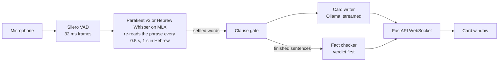

# liveInfo

I made an app that listens to a conversation and pops up info cards about whatever gets mentioned, and calls it out when someone says something wrong. Speech recognition and the LLM both run on the Mac, so nothing leaves the machine and it costs nothing to run.


## The problem

In a meeting, a podcast or a lecture, names and terms go by faster than you can look them up, and looking one up means you stop listening. Assistants that could help want you to ask first, and most of them send your audio to a server.

## What I built

A local app that listens, and about 1.6 seconds after a name is said, shows a card explaining it. No wake word and no typing. It also checks each finished sentence and shows a red card only when a claim is wrong.

- Cards for people, companies, places, technologies, concepts and acronyms
- Fact checks that stay quiet unless the claim is false
- English plus 24 other European languages (Parakeet v3)
- Hebrew (ivrit.ai's Whisper), tuned for tech meetings held in Hebrew with lots of English terms
- Tested on an M4 Pro MacBook Pro with 48 GB

## Architecture



| File | Job |
|---|---|
| `listener.py` | Microphone, voice detection, streaming transcription |
| `cards.py` | Prompts, streamed card parsing, topic dedup, fact checks |
| `app.py` | Wires the two together and serves the page over a WebSocket |
| `static/index.html` | The card window, no build step |

The listener blocks on audio and MLX, so it runs in its own thread. The model calls and the WebSocket run on an asyncio loop, and the thread hands words over with `run_coroutine_threadsafe`.

## Design decisions

- Words are emitted before the sentence ends. The phrase being spoken is transcribed again every 0.5 s, and a word counts as settled once it ended 0.8 s before the newest audio. Waiting for a pause would hold back every card in a long sentence.
- The model reads one clause at a time: at a comma or sentence end, every 8 words, or when the speaker pauses. Whole clauses give it enough context, two-word scraps don't. Words that got no card get a second look together with the words after them.
- Cards are plain `Title | Kind | Body` lines, not JSON. A line can be parsed while it is still streaming, so the card starts filling in on screen after the first few tokens.
- One card per topic. Topics that already have a card are listed back to the model in the prompt, and the parser drops repeats anyway.
- Fact checks give a verdict before any card: wrong, misheard, right or none. Only "wrong" produces a card. The "misheard" verdict exists because speech recognition misspells names, and that is not a factual error.
- One model does both jobs by default, with a small context (2048 tokens) and temperature 0. It is warmed up at start so the first card is fast, and unloaded on quit so two large models never sit in memory together.
- Hebrew goes through ivrit.ai's Whisper large-v3 turbo. Whisper normally encodes a 30 s window on every read; here it only gets the audio heard plus 2 s of silence, which halves a read to 0.3 to 0.6 s. It re-reads once a second, not twice, because it shares the GPU with the card model.
- In Hebrew the model gets a clause every 5 words instead of 8, because one Hebrew word can hold a few English ones: ובקוברנטיס is "and in Kubernetes".
- Whisper learned Hebrew partly from subtitles that wrote ג׳, צ׳ and ז׳ words in Latin letters, with "XD7XB3" for the geresh, so ג'נסן comes out as GXD7XB3NSN. A regex writes these back in Hebrew letters, and a read stuck repeating the same words is cut where the repeating starts.
- When transcription falls behind the microphone, the listener stops re-reading mid-phrase and reads the phrase once it ends, so it catches up instead of lagging further.

## Speed

On an M4 Pro in High Power mode with `gemma4:26b-nvfp4`: a card shows up about 1.6 s after its name is said in conversation, and about 2.4 s in nonstop talk. The model takes about 0.4 s of that. The rest is the speech side settling words and waiting for the clause to end. A fact check shows up 1 to 3 s after the sentence ends. Low Power mode roughly halves card speed.

Hebrew, with `gemma4:26b-nvfp4`, on synthetic meetings (a Hebrew voice plus an English one for the terms): with a term every 3 s, 18 of 19 terms got a card, a median 3 s after the term was said. In a fast design review (182 words a minute, 25 terms such as sharding, CQRS and exponential backoff), 14 to 18 of the 25 got one, a median of about 4 s after and up to 11 s when transcription falls behind. Qwen 35B wrote junk cards in Hebrew ("After" for אחרי) and the 4B did worse, so Gemma is the model for Hebrew.

## Setup

Needs an Apple Silicon Mac, Python 3 and [Ollama](https://ollama.com).

```bash
ollama pull qwen3.5:4b-mlx
```

```bash
python3 -m venv .venv && .venv/bin/pip install -r requirements.txt
```

`app.py` ships with the lightest model selected (`MODEL = MODELS[0]`, 4 GB), so it runs on a small Mac. It writes more junk cards and its fact checks are less reliable. The model that did best in my tests is `gemma4:26b-nvfp4`, which needs about 24 GB of free memory:

```bash
ollama pull gemma4:26b-nvfp4
```

Pick it with `MODEL = MODELS[1]` at the top of `app.py`, or per run with `--model gemma4:26b-nvfp4`.

## Run

```bash
.venv/bin/python app.py
```

For a Hebrew meeting, use Gemma:

```bash
.venv/bin/python app.py --language he --model gemma4:26b-nvfp4
```

A slim window opens (a Chrome app window, or your default browser). On first run macOS asks for microphone access for the app you launched it from. Space pauses and resumes listening. The trash icon clears the cards.

| Option | What it does |
|---|---|
| `--model` | Another Ollama model for this run |
| `--fact-check-model` | A separate model for fact checks, which then run alongside card writing |
| `--language` | `en` or `he` for this run. `LANGUAGE` at the top of `app.py` sets the default |
| `--device` | Microphone name or number (`.venv/bin/python -m sounddevice` lists them) |
| `--port` | Default 8765 |
| `--save-audio FILE` | Also saves what the microphone hears to a .wav, to replay a session |

Tuning knobs: `SETTLED_AFTER_SECONDS` and `READ_EVERY_FRAMES` in `listener.py`, and `WORDS_PER_LOOK`, the prompt and `CLAIM_CHECK` in `cards.py`.

## Tests

```bash
.venv/bin/python -m pytest
```

The model tests need Ollama running with the model pulled. They are skipped otherwise.

## Limits

- The model only knows what it learned in training, so fact checks about recent events can be out of date.
- Don't run other large models in Ollama next to it. Two don't fit in 48 GB together and the Mac starts swapping.
- Hebrew Whisper still garbles some ג׳, צ׳ and ז׳ names said the Hebrew way. The card model usually works out the name from context, and sometimes writes a junk card instead.
- The Hebrew numbers come from synthetic voices, not recorded meetings.
